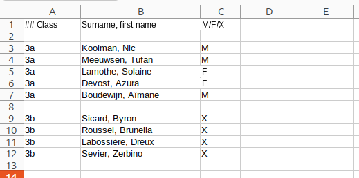

Registering pupils with the server
===


---
Pupils can be registered with the server in bulk by uploading an Excel file. In any case, the pupils' *class* must first
have been added to the school.

**Please note** To be able to take part in a contest, it is not enough for a pupil
to be registered with the server. The pupil must also be subscribed to a specific [event](events.md) that belongs to that contest!

###  Classes

Pupils of a school are grouped into classes. Before you can register pupils, you first have to create the classes.
You do this with the *Add classes* button on the home page. You can register more than one class at a time, by
separating their names with *commas*. Classes with spaces in their names (such as `3 Science`, `Busy beavers`) are allowed. 

Classes have to be created anew each school year.

### Registering pupils via an Excel file

You can register pupils in bulk by uploading an Excel file. This file has to meet a number of conditions:

Empty rows and rows whose first cell begins with # are ignored. Every other row corresponds
    to a pupil. A row must have the following column structure:

* Column **A**: the pupil's **class**. Use the same abbreviation with which you added the class to the school.
    **Attention!** Classes must already have been created before you can upload this file - see above.
* Column **B**: the pupil's **full name**. We suggest that you use surname, comma, space, first name here,
  but this is not mandatory
* Column **C**: the pupil's **gender** - M, F or X. This is only used for
  the international Bebras statistics. You can use X if you want to protect the pupil's privacy.

**Attention!** The worksheet must contain *no formulas*!

You do not have to put all pupils in one file or upload them in one go. 
The same file may contain pupils from different classes.

You can download the [example file](example.xlsx) below and adapt it to your own situation.

Pupils have to be registered anew each school year.

### Bebras ID and password

When this file is uploaded, the application will generate a *Bebras ID* and a *password*
for the pupils. They need these to log in and take part in the contest. The teacher
can download an Excel file with the Bebras ID and password of all pupils of the school.

Only the teacher can change a pupil's password.

### Individual registration

Pupils can also be registered individually, without having to use an Excel file. You can do this on the
pupils page, under the class in question, but also on the events page, when you want to add a pupil
at the last minute and give them access to that event right away.
