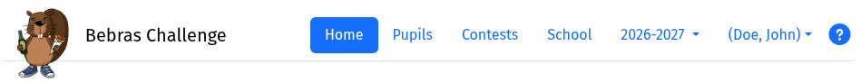

Menu overview
===
See also
* [Documentation - main page](index.html)
* In brief - [taking part in the Bebras Challenge](brief.html)

#### The main menu

{: width="75%"}

Home 
: Classes and events for your school. See below.

Pupils
: [Registration](registration.md) of pupils with the server.

Contests
: Overview of all available contests, contest questions and solutions. Also makes it possible
to view all results of one contest (across all events) and to create a new event.

School
: School and registered teachers. Register a colleague.

School year
: School year used for the data shown. Can only be changed on the home page. For previous 
  school years you can only view the data, but no longer change it.

Logged-in user
: Contains a drop-down menu (see below)

?
: Opens these documentation pages

#### Drop-down menu of the logged-in user

* Change password
* Change language - of the user interface
* Correct your name - in case we have spelled it wrongly
* Log out

#### Events

You find these on the **Home** page. 

Clicking an event's *Details* button gives you the following possibilities
* Open/close the event
* Subscribe/unsubscribe pupils for that event (give permission to take part)
* During the event: see who is taking part, give a pupil extra time, etc.
* After the event: download results

Under the **Contests** menu you will also find a list of events *for a specific contest*. There you also have
the option to create a new event *for that specific contest*, as an alternative to
the above.
