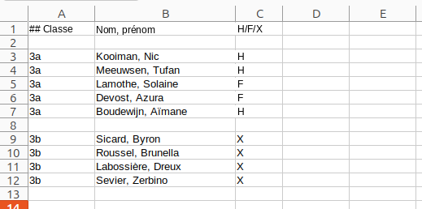

Enregistrer des élèves sur le serveur
===


---
Les élèves peuvent être enregistrés en groupe sur le serveur en chargeant un fichier Excel. Dans tous les cas, la *classe* des
élèves doit d'abord avoir été ajoutée à l'école.

**Attention** Pour pouvoir participer à un challenge, il ne suffit pas qu'un élève
soit enregistré sur le serveur. L'élève doit aussi être inscrit à un [évènement](evenements.md) précis qui appartient à ce challenge !

###  Classes

Les élèves d'une école sont regroupés en classes. Avant de pouvoir enregistrer des élèves, vous devez d'abord créer les classes.
Vous le faites avec le bouton *Ajouter des classes* de la page d'accueil. Vous pouvez enregistrer plus d'une classe à la fois, en
séparant leurs noms par des *virgules*. Les classes dont le nom contient des espaces (comme `3 Sciences`, `Petits castors`) sont autorisées. 

Les classes doivent être créées à nouveau chaque année scolaire.

### Enregistrer des élèves via un fichier Excel

Vous pouvez enregistrer des élèves en groupe en chargeant un fichier Excel. Ce fichier doit satisfaire à un certain nombre de conditions :

Les lignes vides et les lignes dont la première cellule commence par # sont ignorées. Toute autre ligne correspond
    à un élève. Une ligne doit obligatoirement avoir la structure de colonnes suivante :

* Colonne **A** : la **classe** de l'élève. Utilisez la même abréviation que celle avec laquelle vous avez ajouté la classe à l'école.
    **Attention !** Les classes doivent déjà avoir été créées avant que vous puissiez charger ce fichier - voir ci-dessus.
* Colonne **B** : le **nom complet** de l'élève. Nous suggérons d'utiliser ici le nom de famille, une virgule, un espace, puis le prénom,
  mais ce n'est pas obligatoire
* Colonne **C** : le **genre** de l'élève - H, F ou X. Ceci n'est utilisé que pour
  les statistiques internationales de Bebras. Vous pouvez utiliser X si vous souhaitez protéger la vie privée de l'élève.

**Attention !** La feuille de calcul ne doit contenir *aucune formule* !

Vous ne devez pas placer tous les élèves dans un seul fichier ni les charger en une seule fois. 
Un même fichier peut contenir des élèves de classes différentes.

Vous pouvez télécharger le [fichier d'exemple](example.xlsx) ci-dessous et l'adapter à votre propre situation.

Les élèves doivent être enregistrés à nouveau chaque année scolaire.

### ID Bebras et mot de passe

Lors du chargement de ce fichier, l'application génère un *ID Bebras* et un *mot de passe*
pour les élèves. Ils en ont besoin pour se connecter et participer au challenge. L'enseignant
peut télécharger un fichier Excel contenant l'ID Bebras et le mot de passe de tous les élèves de l'école.

Seul l'enseignant peut modifier le mot de passe d'un élève.

### Enregistrement individuel

Les élèves peuvent aussi être enregistrés individuellement, sans devoir passer par un fichier Excel. Vous pouvez le faire via la
page des élèves, sous la classe concernée, mais aussi via la page des évènements, lorsque vous voulez (à la dernière minute) ajouter un élève
et lui donner immédiatement accès à cet évènement.
