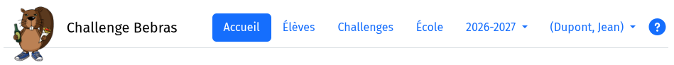

Aperçu du menu
===
Voir aussi
* [Documentation - page principale](index.html)
* En bref - [participer au Challenge Bebras](en-bref.html)

#### Le menu principal

{: width="75%"}

Accueil 
: Classes et évènements de votre école. Voir ci-dessous.

Élèves
: [Enregistrement](enregistrement.md) des élèves sur le serveur.

Challenges
: Aperçu de tous les challenges disponibles, des questions des challenges et des solutions. Permet aussi
de consulter tous les résultats d'un challenge (tous évènements confondus) et de créer un nouvel évènement.

École
: École et enseignants inscrits. Inscrire un collègue.

Année scolaire
: Année scolaire utilisée pour les données affichées. Ne peut être modifiée que sur la page d'accueil. Pour les 
  années scolaires précédentes, vous ne pouvez que consulter les données, mais plus les modifier.

Utilisateur connecté
: Contient un menu déroulant (voir plus loin)

?
: Ouvre ces pages de documentation

#### Menu déroulant de l'utilisateur connecté

* Modifier le mot de passe
* Modifier la langue - de l'interface utilisateur
* Corriger votre nom - au cas où nous l'aurions mal orthographié
* Se déconnecter

#### Évènements

Vous les trouvez sur la page **Accueil**. 

Un clic sur le bouton *Détails* d'un évènement vous offre les possibilités suivantes
* Ouvrir/fermer l'évènement
* Inscrire/désinscrire des élèves pour cet évènement (donner l'autorisation de participer)
* Pendant l'évènement : voir qui participe, accorder du temps supplémentaire à un élève, etc.
* Après l'évènement : télécharger les résultats

Dans le menu **Challenges**, vous trouvez aussi une liste d'évènements *pour un challenge précis*. Vous y avez aussi
la possibilité de créer un nouvel évènement *pour ce challenge précis*, comme alternative à
ce qui précède.
